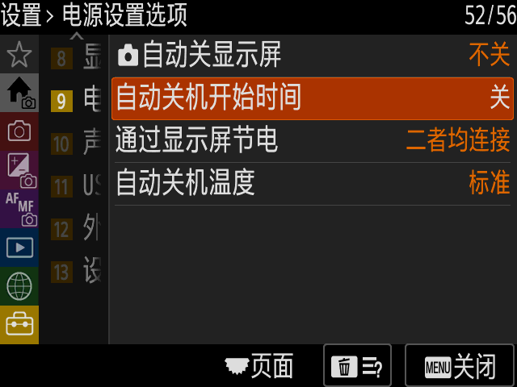

# Sony A7 IV / A7M4 QEMU Research

**v0.1 · ILCE-7M4 固件 6.02 · 研究中的模拟运行环境**

原创贡献使用 [MIT License](LICENSE)，第三方代码与资源的例外见 [NOTICE](NOTICE.md)。2026-10-28 已完成公开前的历史与内容检查，范围和结果见 [公开检查记录](outputs/sony-a7iv-qemu/native/PUBLIC-REVIEW.zh-CN.md)。

在定制 QEMU 中运行 Sony A7 IV 的原厂应用与界面，研究启动、显示、输入、存储和协处理器协议。参考 [chocotan/a7c2-re](https://github.com/chocotan/a7c2-re/tree/25efb56d7f0c69355f9225d1da50454207532e7f)，对 A7M4 的地址、资源与协议单独适配。

**已验证主界面和部分基础功能；完整原厂取景、AF、ISP、JPEG 拍摄链路尚未实现。** 网页的视频输入、JPEG 写卡及回放覆盖层是模拟功能，不能作为原厂拍照成功的证据。仓库不包含 Sony 固件、分区镜像或用户视频，也不是下载后直接运行的整机模拟器。

## 当前进展

| 范围 | 已保存的验证结果 |
| --- | --- |
| 原厂界面与输入 | 主界面、菜单、Fn、返回；原厂 AP 像素与 QEMU 显示比对 |
| 原厂中文菜单 | 原厂简体中文资源与字体；语言页和菜单截图 |
| 虚拟卡槽 2 | 64 MiB FAT32，原厂媒体数据库/XML 写入，原厂空卡回放 |
| 启动与重启 | 带卡基线实际冷启动、重启和连续操作检查 |
| 音效实验 | 原厂 AP 注册表对应的 guest 音频字节，经虚拟 CP 触发并由浏览器渲染；未执行原厂 CP/AIP |
| 网页模拟拍摄 | 浏览器视频帧生成 JPEG，guest helper 写入虚拟卡，网页覆盖层回放；未走原厂成像/编码器 |
| 修改固件样本 | 提取后的 AP/UI 与部分音效资源可运行；未验证整包 CRC、签名、升级器接受性或真机刷写 |

上述功能各自有独立实验记录，不表示它们在单一配置中通过了完整回归。最近功能证据记录于 2026-10-21；2026-10-25 进行仓库整理，没有重新运行全部相机实验。

## 文档入口

- [工程结构与源码入口](docs/STRUCTURE.md)
- [环境准备、构建顺序与运行限制](docs/REPRODUCING.md)
- [当前状态及历史里程碑](outputs/sony-a7iv-qemu/native/STATUS.zh-CN.md)
- [详细进展报告](outputs/sony-a7iv-qemu/native/项目进展报告.zh-CN.md)
- [原厂中文菜单验证](outputs/sony-a7iv-qemu/native/evidence/camera-menu-zh-20261021/README.md)
- [虚拟 CP 与固件音效实验](outputs/sony-a7iv-qemu/native/evidence/firmware-sound-virtual-cp-20261021/README.md)
- [网页 JPEG 写卡与回放边界](outputs/sony-a7iv-qemu/native/evidence/web-playback-sound-20261021/README.md)
- [修改固件样本验证](outputs/sony-a7iv-qemu/native/evidence/firmware-validation-allquiet35-20261021/README.md)
- [变更记录](CHANGELOG.md) · [第三方来源与权利说明](NOTICE.md)

## 本机使用

已有本机环境时，运行 [Start-Camera.cmd](outputs/sony-a7iv-qemu/native/Start-Camera.cmd) 复用现有网页或启动固定基线。该启动器仍固定为 10 月 19 日的带卡基线；中文和音效候选实例另见各自证据，不能保证通过该启动器重建后续实验。

依赖 Windows、WSL `Codex-Z8-Qemu`、已构建的定制 QEMU 11.1.2，以及自行准备的 6.02 固件数据。脚本包含原开发机路径，首次克隆需要按 [复现说明](docs/REPRODUCING.md) 调整，不能直接双击视为安装完成。默认实验没有连接真实相机、USB 或物理存储卡。

## 版本约定

根目录 [VERSION](VERSION) 保持 `0.1`。`v0.1` 标签保留最初基线提交 `3fcc1c3`；后续功能和工程整理继续提交到 `main`，不移动标签、不自动递增版本。需要对照最新源码时使用 `main`；需要还原最初验收时使用 `v0.1`。
