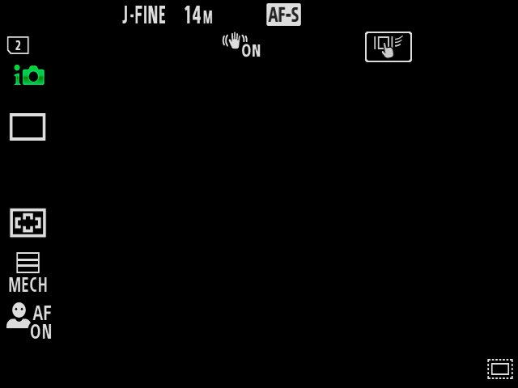

# Sony A7 IV（A7M4）QEMU 项目进展报告

项目版本：**v0.1**，使用本地 Git 提交和 `v0.1` 基线标签管理，详见 [版本管理](版本管理.zh-CN.md)。

基线报告日期：2026-10-19；后续实验摘要补充于 2026-10-21。目标机型：Sony ILCE-7M4；当前验证固件：6.02。本文记录本机已完成的实验，不代表已验证报告日期的最新固件版本。最新工程导航见仓库根目录 README。

> 2026-10-21 更新：原厂相机菜单已切换为简体中文（首次设置语言页高亮“简体中文”，主菜单为中文）；宿主固件音面板仍为中文，HALF 产生 48 kHz FocusLock，电子快门默认静音。实现方式和截图见 [原厂相机菜单简体中文](evidence/camera-menu-zh-20261021/README.md)。

## 当前结论

**原厂主界面、菜单、Fn、虚拟卡槽 2、媒体数据库写入、空卡回放及重新启动已跑通；实时取景、自动对焦、JPEG 生成和实际拍照尚未实现。** 当前达到的是“原厂界面和部分控制、存储路径可运行”，距离“完整相机功能”仍有成像链路需要实现。

2026-10-19 的基线实例为 `native-117-card-main`，使用独立验证过的带卡镜像。冷启动通过，实际重启约 104 秒后恢复；重启前后均验证回放、返回主界面及 Fn 操作。网页显示实际 QEMU 缓冲内容，多个关键画面通过原厂 AP 快照与 QEMU/网页整帧 RGB 比对。后续中文、音效与修改固件实例见各自证据，此处不表示网页当前仍运行该实例。

[打开当前本机界面](http://localhost:18764/S5jrCd45BfZKkoQmYa7c0ASfeT12LoLl/) · [详细使用说明](MAIN-UI.zh-CN.md) · [基础功能清单](BASIC-FUNCTIONS.zh-CN.md)

## 功能完成度

| 功能 | 当前状态 | 验证范围与限制 |
| --- | --- | --- |
| 原厂启动与主界面 | 已验证 | 启动原厂 AP 应用，重放初始设置并关闭省电；使用部分软件硬件端点模型 |
| 方向键、确认、MENU | 已验证 | 按键送入原厂输入路径，可导航菜单并返回主界面 |
| Fn 快捷面板 | 已验证 | 可打开、退出；空卡回放后仍可使用 |
| 卡槽 2 | 已验证 | 原厂驱动和文件后端挂载 64 MiB FAT32 虚拟卡，照片记录目标设为 Slot 2 |
| 文件系统写入 | 已验证 | 原厂程序实际创建媒体数据库与 XML；不等于已经生成照片 |
| 空卡回放 | 已验证 | 原厂显示“No images”，再次按回放可回主界面 |
| 虚拟机重新启动 | 已验证 | QEMU 进程确实更换，自动恢复初始设置和 Slot 2，随后操作检查通过 |
| 半按与快门事件 | 已发送并检查 | 整卡 SHA-256 未变化，未出现照片文件；拍照未实现 |
| 实时取景、传感器与 ISP | 未实现 | 当前没有真实或虚拟图像帧进入完整成像流程 |
| 自动对焦、JPEG 编码与保存 | 未实现 | 尚无对应成像结果和端到端验收 |
| 卡槽 1 | 未实现 | 混合介质所需 PCI/SxS 后端仍缺失 |
| 重启后保留卡内容与个人设置 | 未实现 | 当前使用内存内虚拟卡，重启清空并重新初始化 |
| 完整 CP 成像固件执行 | 未实现 | 目前只按已确认的协议实现部分控制模型 |

网页“保存截图”保存的是界面 PNG，不能当作相机快门拍摄的照片。

## 本轮主要进展

### 1. 从可用菜单推进到带卡原厂主界面

沿用原厂应用、资源、驱动和原生 IPC 路径，补充缺失的启动与显示控制端点。此前仅菜单可用的状态已经推进到可进入主界面，并可以持续使用菜单、Fn 和回放。

带卡配置使用原厂 `mcmn_drv.ko` 及文件后端，挂载 Slot 2；通过原厂菜单将照片记录介质设置为 Slot 2。Slot 1 的 PCI/SxS 路径没有以虚构设备状态代替完成。

### 2. 证明原厂程序确实写入虚拟卡

虚拟卡初始只预置空的 DCIM 目录。只读 FAT32 审计确认，原厂程序随后创建了：

| 路径 | 字节数 |
| --- | ---: |
| `/PRIVATE/DATABASE/DATABASE.BIN` | 9,670,656 |
| `/PRIVATE/M4ROOT/MEDIAPRO.XML` | 405 |

快门前后对整张卡做 SHA-256 校验。native116 的前后哈希相同，均为 `8863a98a82fca07890a95ff4ac4cd93e1e916c3cf6baeb7c85274f1dfbbf7b73`。这同时证明“媒体数据库能够写入”和“本轮快门没有产生照片”。不同启动会重新创建数据库，不能跨启动用不同哈希推断拍照或持久化成功。

[卡写入与快门审计：native105–116](evidence/capture-and-card-audits.json)

### 3. 修复空卡回放导致的原厂断言

修复前，进入回放后线程进入崩溃转储，界面失去响应。内核栈、原厂标准错误和消息追踪共同定位到虚拟显示端拒绝了一条合法的 EVF 优先级配置。

原厂 CP 代码表明，`200d/0118` 消息偏移 20（从 0 起计）的字节是 EVF 优先级，合法值为 0、1、2。旧模型只接受 1，原厂回放发送 2 时返回失败，触发 AP 原厂断言。修复只扩展了这一字段的合法范围，其他消息字段仍严格校验；没有绕过断言，也没有增加通用成功应答。

native115、116 修复后，Fn、MENU、回放、回放返回及再次使用 Fn 的六项连续操作检查全部通过，八个检查画面与原厂 AP 快照逐字节一致。native117 在实际网页冷启动和重启后也通过了相应操作检查。

[回放修复的原厂代码位置、前后结果与截图校验](evidence/evf-priority-playback-fix.json)

### 4. 消除诊断消息积压并限制日志占用

原厂 AP 会发送单向诊断记录。模型现在只接收已确认调用来源、消息类型、长度与边界的记录，保存后按原厂规则释放消息，避免队列因无人接收而阻塞。未知消息与同步 IPC 不做通用消费。

审计工具校验完整诊断流的记录结构与 SHA-256，并导出最多 512 KiB 的末尾完整记录；新导出工具还提供独立样本 SHA-256，供主机复核。运行时仅保留最近两段日志，每段最多 8 MiB，轮换已实测。

native115 的功能检查通过，但当时诊断导出被内核警告插入串口 Base64 而失败。原始失败结果保留，后续恢复证据单独记录；该旧样本缺少独立样本哈希，不能宣称整轮导出无异常。随后 native116 使用改进后的工具完整通过。

### 5. 固定带卡镜像并完成当前网页切换

native116 验证过的镜像已固定为 `main-virtual-card-stable.cpio`，并由 native117 接替原先网页实例。实际重启返回成功，用时约 103.97 秒；QEMU PID 从 269067 更换为 270922。重启后的六张操作截图均与 native116 对应参考帧一致。

重启前后分别读取原厂 AP 快照，独立校验后与网页整帧 RGB 对比，结果均一致。这个结果证明当前展示的画面来源，不代表完整 CP 合成、面板硬件或全部异步确认已经实现。

[当前配置与重启验证汇总](evidence/card-profile-promotion.json) · [重启后操作像素比对](evidence/live117-after-restart-pixels.json) · [重启后只读审计](evidence/live117-after-restart-audit.json)

## 当前实际画面

原厂带卡主界面：

原厂空卡回放页面：

## 实现范围与固件边界

项目参考 [chocotan/a7c2-re 的固定提交](https://github.com/chocotan/a7c2-re/tree/25efb56d7f0c69355f9225d1da50454207532e7f)，目标已迁移到 A7M4 6.02。当前使用官方更新包提取的原厂内核、应用与资源，并结合定制 QEMU、运行时适配和缺失端点的软件模型；不依赖从实体相机完整 dump 的系统分区来完成本次已验证的界面实验。

这不意味着官方更新包天然能在通用 QEMU 上直接启动。当前环境还依赖已构建的板级支持、时钟与输入适配、部分服务配置及运行时模型。原厂应用和 CP 文件的固定哈希见证据文件；运行时存在适配钩子，因此不能把结果描述为“完整未改动固件已经直接裸跑”。

关于此前的自定义固件问题：当前环境能够用于修改虚拟机侧适配代码和实验运行环境，但任意自定义固件的兼容启动、签名接受、完整功能及实体相机刷入均未验证。

## 如何继续使用与复现

1. 已运行时，使用上方本机网页链接；也可双击本目录的 [Start-Camera.cmd](Start-Camera.cmd)。
2. 在网页操作方向键、确认、MENU、Fn 和回放。空卡回放显示“No images”；再次按回放返回。
3. 重新启动会清空卡内容与个人设置，然后自动重放初始设置、关闭省电并选择照片 Slot 2。
4. 如需重新打开环境，启动器会复用现有网页；没有实例时校验固定镜像哈希再启动。

启动器已经通过 PowerShell 语法检查，同参数冷启动、网页操作和实际重启已验证；尚未额外关闭当前实例后独立调用启动器文件。运行脚本保存在 [runtime 目录入口](runtime/native-session.py)。本目录不包含完整 Sony 固件，也不是复制到其他电脑即可运行的便携包。

| 本机依赖 | 位置或版本 |
| --- | --- |
| WSL 发行版 | `Codex-Z8-Qemu` |
| 定制 QEMU | 已构建的 11.1.2，Linux `/opt/sony-a7iv` 环境 |
| 固件及运行数据 | `D:\CodexWork\sony-a7iv-qemu` |
| 固定带卡镜像 | `D:\CodexWork\sony-a7iv-qemu\menu-a7m4\main-virtual-card-stable.cpio` |
| 镜像大小 | 471,859,200 字节 |
| 镜像 SHA-256 | `ef7ed4046bcd3ccc0ea42f03550a958459272fb134ac61fac6f7a734f2a304d4` |
| 原始 BODYDATA SHA-256 | `ad6df47a0a93a46336b9920a0d8891d0c766f8c96fa68ebda8685f6c21621188` |

旧主界面镜像仍保留。实验没有连接真实相机、物理存储卡或 USB 设备。

## 下一阶段优先事项与验收标准

1. **建立成像数据源和流转路径。** 确认快门前后的原厂状态机、帧请求、缓冲区及完成事件，补齐必要的传感器/CP/ISP 模型。以原厂界面出现持续更新的图像帧为验收，静态背景不算实时取景。
2. **打通照片生成与保存。** 从快门事件追踪到曝光、编码及文件系统写入。以生成可独立解码的 JPEG、整卡哈希变化、原厂回放能读取同一张照片为验收。
3. **完善稳定性和持久化。** 在成像路径成立后验证连续拍摄、菜单切换、回放往返与长时间运行；增加可控的卡镜像和设置持久化，避免重启丢失。
4. **扩展尚缺硬件功能。** 另行实现并验证自动对焦、其他介质及 Slot 1 等路径，按具体协议和原厂行为逐项验收。

目前的主要缺口是成像链路，不能仅靠补界面或成功应答证明已经拍照。后续每项功能都应保留原厂消息、图像与文件证据。

## 文档与证据索引

- [简明使用说明](MAIN-UI.zh-CN.md)：打开方式、按键、重启与限制。
- [基础功能进展](BASIC-FUNCTIONS.zh-CN.md)：当前能力、修复内容与主要证据。
- [历史状态记录](STATUS.zh-CN.md)：最新结论及此前主界面里程碑。
- [配置推广与重启验证](evidence/card-profile-promotion.json)：固定镜像、当前实例与审计。
- [回放问题定位与修复](evidence/evf-priority-playback-fix.json)：原厂协议语义、失败原因及检查结果。
- [卡写入与快门审计](evidence/capture-and-card-audits.json)：各次实验、成功与失败记录及恢复说明。
- [重启前审计](evidence/live117-before-restart-audit.json)、[重启后审计](evidence/live117-after-restart-audit.json)：卡文件、日志大小、原厂 AP 与网页显示比对。
